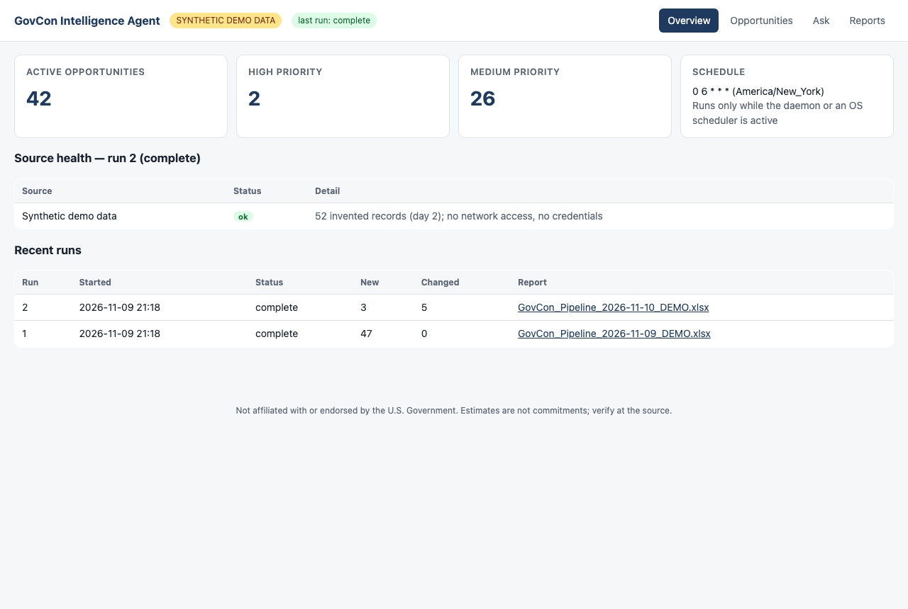
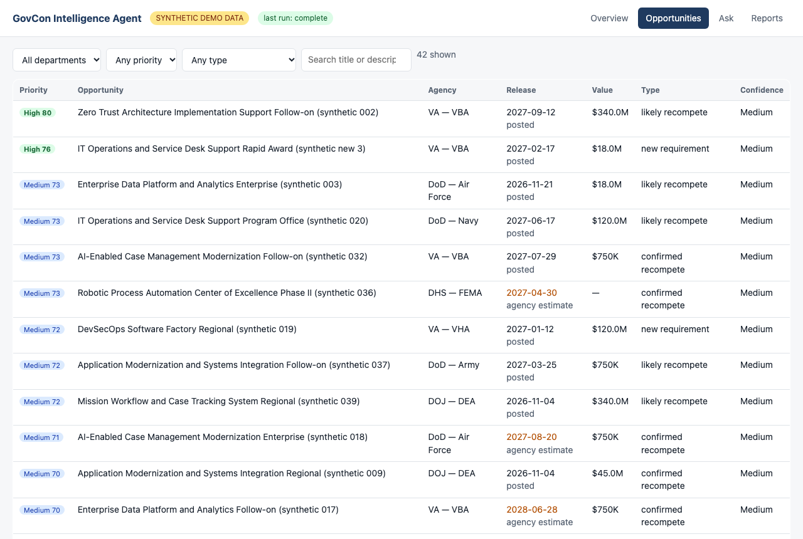
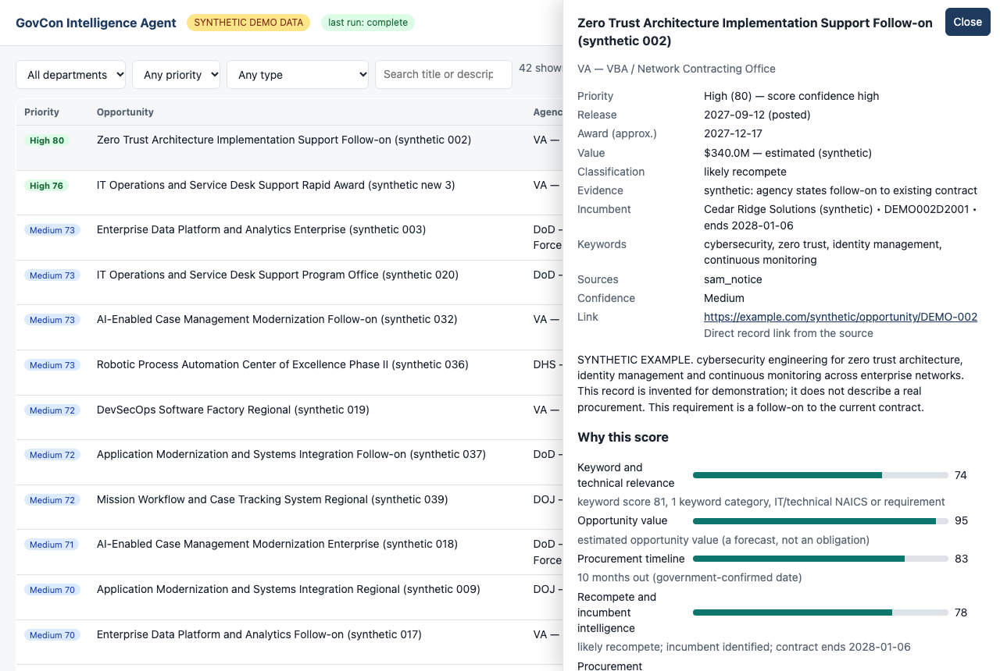
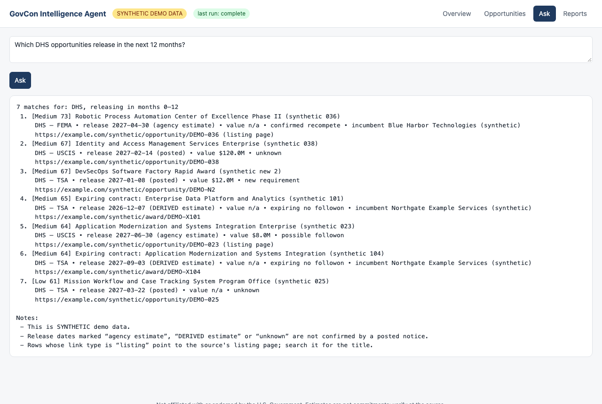

# GovCon Intelligence Agent

An open-source, local-first agent that finds U.S. federal contracting opportunities from **free public sources**, detects what is new or changed, spots recompetes and incumbents, scores every opportunity with a transparent six-factor model, and writes a **daily 7-sheet Excel report**. Ask questions in plain English, with or without an AI model.

> **Not affiliated with, endorsed by, or sponsored by the U.S. Government** (or SAM.gov, USAspending.gov, GSA, GAO or any agency). Data comes from public sources and may be incomplete or wrong. Dates and values marked *estimate* are **not** commitments. Always verify at the original source before acting. See [Disclaimer](#disclaimer).



All screenshots in this repository use **synthetic demo data** (fictional companies, `example.com` links).

## Why

Capture teams spend hours each week combing SAM.gov, forecasts and award data. This tool does the sweep for you, every morning, on your own machine: no SaaS, no account, no telemetry.

## Features

- **Configurable discovery**: your keywords, NAICS codes, departments and value floor live in one JSON profile.
- **Free public sources**: SAM.gov (your own free API key), USAspending (expiring contracts, incumbent lookup), GSA Acquisition Gateway forecast, GAO reports (market signals).
- **New / changed detection** with material-change thresholds (date shift ≥ 14 days, value change ≥ 20%; configurable).
- **Recompete and incumbent detection**, with the evidence stated for each classification.
- **Verified vs. estimated honesty**: every date carries its basis (government / agency estimate / imported / derived) and every link says whether it is a direct record link or only a listing page.
- **Six-factor Opportunity Intelligence Priority** (relevance 30, value 20, timeline 15, recompete 15, maturity 10, agency 10) with High ≥ 76, Medium ≥ 64, Low ≥ 52, otherwise Watch. Every score is explained. See [docs/SCORING.md](docs/SCORING.md).
- **Daily schedule**: built-in daemon, or generated launchd / systemd / Task Scheduler entries.
- **7-sheet Excel report**: Executive Summary, Master Opportunities, New & Changed, Recompetes, 18-24 Month Outlook, Capture Priorities, Data Quality.
- **Partial-run honesty**: if a source fails or hits a limit, the report says so instead of silently dropping data.
- **Natural-language queries** ("which DHS opportunities release in the next 12 months?") answered deterministically; an optional LLM (Ollama, Anthropic, OpenAI-compatible) can translate or rephrase but can never add facts.
- **Local web UI** bound to `127.0.0.1` by default.
- **Plugin interface** for licensed/private sources and a generic CSV importer. No vendor-specific code ships here.

| Opportunities | Detail with score explanation | Ask |
|---|---|---|
|  |  |  |

A sample report is in [examples/GovCon_Pipeline_DEMO.xlsx](examples/GovCon_Pipeline_DEMO.xlsx) (synthetic).

## Quick start

Requires **Node.js 24 or newer** (uses the built-in `node:sqlite`; no database server).

```bash
git clone https://github.com/jango-labs/govcon-intelligence-agent.git
cd govcon-intelligence-agent
npm install
npm run demo        # synthetic data, no network, no credentials
npm run serve -- --demo   # browse it at http://127.0.0.1:8787
```

Then make it yours:

```bash
npm run setup       # guided: profile, optional SAM.gov key, schedule
npm run doctor      # checks configuration and (with --live) connectivity
npm run run         # one real discovery run
npm run ask -- "high priority recompetes in the next 12 months"
```

Full instructions: [INSTALL.md](INSTALL.md). Settings reference: [CONFIGURATION.md](CONFIGURATION.md).

## Data sources and licensing boundary

| Source | Access | Notes |
|---|---|---|
| SAM.gov Opportunities API | your own free key | Required for solicitations/notices. Without it the run reports the source as *skipped*. |
| USAspending API | public | Expiring contracts, incumbent lookup by PIID. |
| GSA Acquisition Gateway forecast | public | Uses an undocumented public JSON feed; may change without notice. |
| GAO reports (RSS) | public | Stored as market signals, not opportunities. |
| CSV import | file | Bring an export from any tool you are licensed to use. |
| Plugins | you | Implement a small interface; see [docs/CONNECTORS.md](docs/CONNECTORS.md). |

Commercial services (for example paid market-intelligence subscriptions) are **not** included and no data from them is redistributed. See [docs/LICENSING.md](docs/LICENSING.md) and [docs/DATA_SOURCES.md](docs/DATA_SOURCES.md).

## Privacy and security

Runs locally. No telemetry, no phone-home. The only outbound requests go to the sources you enable (and an LLM provider only if you configure one). Secrets live in `.env` (gitignored) or your OS keyring. See [SECURITY.md](SECURITY.md).

## Documentation

[INSTALL](INSTALL.md) · [CONFIGURATION](CONFIGURATION.md) · [Architecture](docs/ARCHITECTURE.md) · [Scoring](docs/SCORING.md) · [Connectors](docs/CONNECTORS.md) · [Data sources](docs/DATA_SOURCES.md) · [Licensing](docs/LICENSING.md) · [Security](SECURITY.md) · [Contributing](CONTRIBUTING.md) · [Changelog](CHANGELOG.md)

## Disclaimer

This software is provided "as is" under the MIT License for informational purposes. It is not legal, financial or procurement advice. Scores are heuristics, not predictions. Estimated dates and values are not government commitments. Respect each data provider's terms of use and rate limits.
